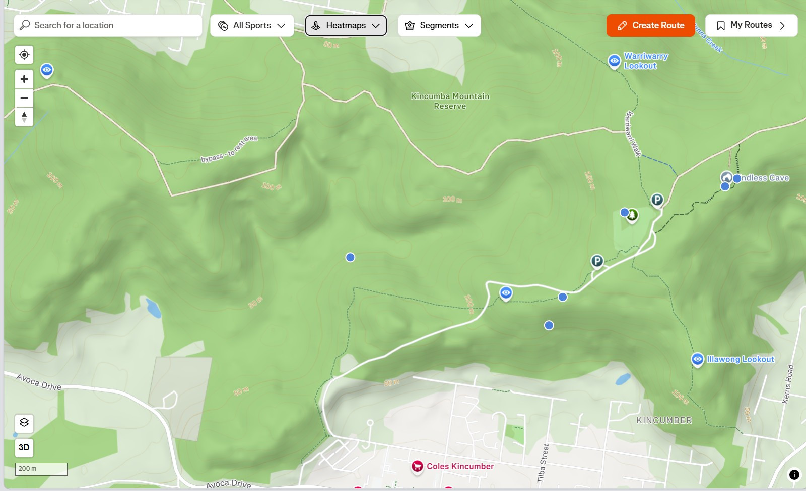
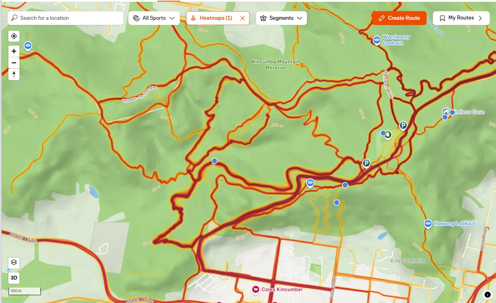
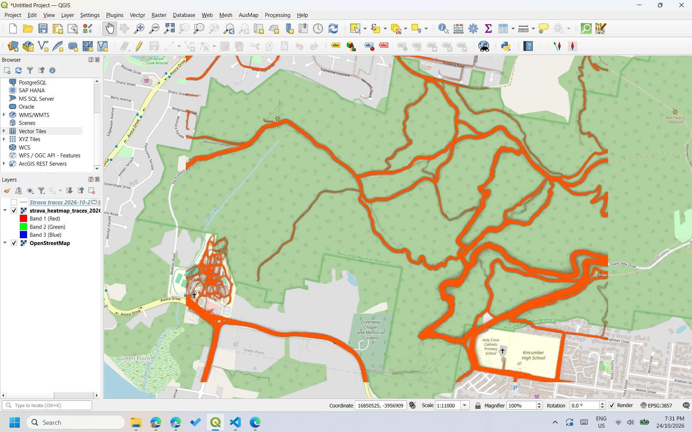
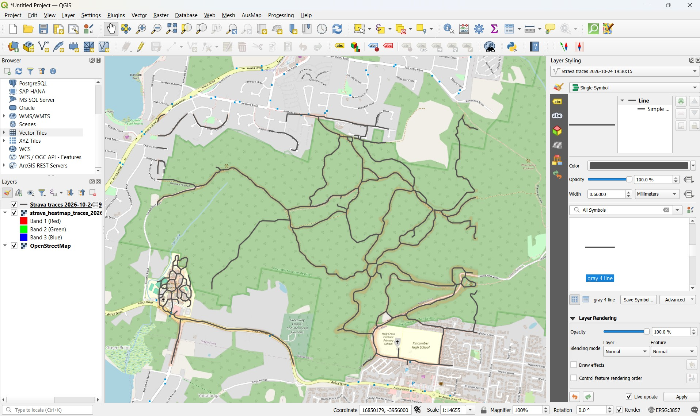
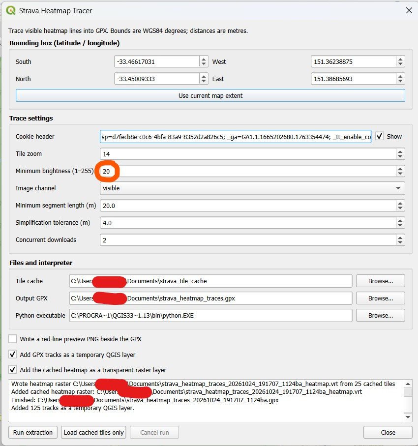
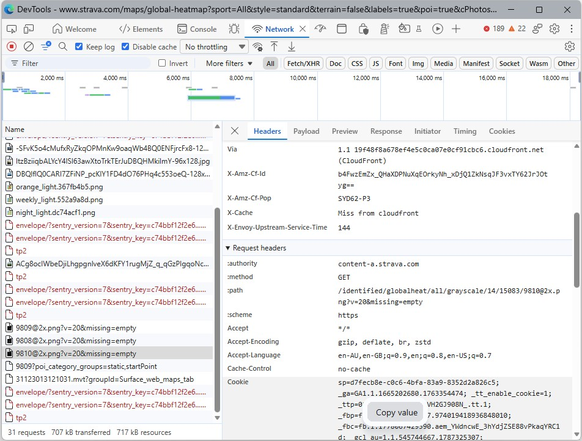

# Strava Heatmap Tracer + QGIS Integration

## The Strava Heatmap
The Strava heatmap 'heat' made by aggregated, public activities recorded on Strava over the past year, updated monthly. It can contain data not present in mapping datasets for a variety of reasons including:
* The track is for private use only
* The route is a common off-track corridor and not a physical track on the ground
* A single person is very committed to riding that route twice a day, every day
* The track simply hasn't been added to OSM yet!

<table>
  <tr>
    <td align="center"><b>Normal OSM-based map</b></td>
    <td align="center"><b>Strava Heatmap</b></td>
  </tr>
  <tr>
    <td></td>
    <td></td>
  </tr>
</table>

In any case, if you would like to trace the data in the Strava Heatmap, this plugin may be of use. 

## Usage

You may use this plugin directly in python by invoking `./extractor.py` after modifying the relevant co-ordinate values and Cookie header (read below).

Or, you may use the QGIS plugin frontend to load the traced data.

Image of the simple scraped tiles from Strava, loaded into QGIS:

Image of the inferred GPS lines along the heatmap corridors:

## QGIS Plugin

Install the ZIP through **Plugins → Manage and Install Plugins → Install from ZIP**.
Open **Plugins → Strava Heatmap Tracer → Trace Strava heatmap…**.

Select the Python executable where `numpy`, `scipy`, and `pillow` are installed. 
If needed, install them in that interpreter with `python -m pip install numpy scipy pillow`.

The dialog exposes the four latitude/longitude bounds, a button to take the current QGIS map extent, cookie header value (see below section), tile zoom, **brightness threshold**, signal channel, minimum segment length, simplification, download workers, cache folder, output GPX and optional preview. The cookie is passed in the child process environment for that run; the plugin does not save it.

The **Maximum brightness** field in the plugin will be the most common point of configuration. It controls how bright (ie. how "travelled") a route should be, to get interpreted as a gps track. 20 to 40 is the range you want to try in.

Check **Add the cached heatmap as a transparent raster layer** to create a georeferenced VRT alongside the GPX and load it into QGIS when extraction finishes. **Load cached tiles only** builds and loads that layer from tiles already on disk, without downloading or tracing. Each VRT references its own neighbouring `*_tiles` folder, so later runs do not change an earlier raster.

The GPX is copied into a QGIS **temporary memory layer**, which is independent of the GPX file. If the chosen GPX output filename already exists, a timestamp and short unique suffix are added so existing files remain intact. Temporary QGIS vector layers are not persistent across QGIS restarts; export any you want to keep. Keep a VRT and its `*_tiles` folder together if moving the raster. 

The output is an inferred centerline network from an aggregate image. It includes roads as well as paths and may include off-trail use or GPS errors. Review individual candidates before using them as trails or editing OSM.

Screenshot of the QGIS dialog:

## Cookie Extraction

Strava Heatmap is only available to logged in users. In order for the plugin to access it, it needs your cookie.

To get your cookie, navigate to the heatmap page (https://www.strava.com/maps/global-heatmap) and open the Developer Tools (right-click, Inspect Element). Navigate to the Network tab.

Scroll through the rows until you find a row of the type `12345@2x.png?etc...`.

Open that row and scroll to "Cookie" in the "Request Headers" section. Copy that value.

That is the value you need to paste into the plugin.

## Credits and License

This code is released with no guarantee and under the [Unlicense](https://unlicense.org/). 

This code was developed partially by GPT-6.